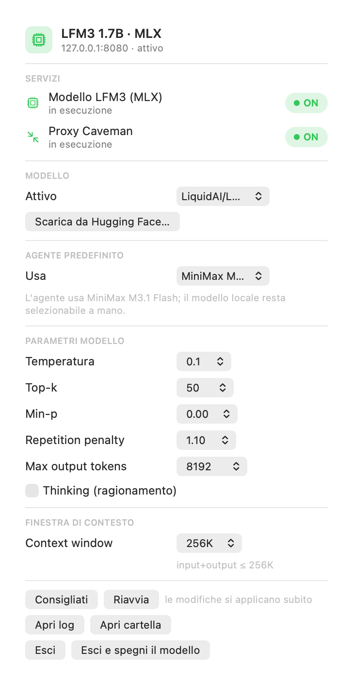

# MLX Control



**Menu Bar Extra per macOS che rende MiniMax Code usabile con un modello locale.**

MLX Control installa e governa uno stack completo e **tutto locale**:

- un **server MLX** (Apple Silicon) che espone LFM3 e altri modelli MLX con API OpenAI-compatible;
- la registrazione del provider `mlx` dentro **MiniMax Code**, così il modello locale diventa un
  provider custom selezionabile come qualsiasi altro;
- una **compattazione del contesto** alternativa, basata su [Rizzo Flow](https://github.com/Rizzo-AI-Academy/rizzo-flow),
  che rende la "Compacting context" da minuti a pochi secondi;
- una **Menu Bar Extra** per accendere/spegnere, cambiare modello e parametri, e installare i modelli
  con un clic.

Nessun dato esce dal computer: modello, compattazione e cache restano sulla macchina.

---

## Indice

- [Requisiti](#requisiti)
- [Installazione](#installazione)
- [Come funziona](#come-funziona)
- [Compattazione del contesto](#compattazione-del-contesto)
- [La Menu Bar Extra](#la-menu-bar-extra)
- [Comandi da terminale](#comandi-da-terminale)
- [Dove stanno i file](#dove-stanno-i-file)
- [Configurazione di MiniMax Code](#configurazione-di-minimax-code)
- [Problemi frequenti](#problemi-frequenti)
- [Sviluppo](#sviluppo)
- [Licenza](#licenza)

---

## Requisiti

| | |
|---|---|
| macOS | 13.0 o successivo, Apple Silicon (M1+) |
| MiniMax Code | installato e avviato almeno una volta |
| Spazio | ~1,2 GB per LFM3-1.7B-4bit, ~1,8 GB per Rizzo Flow |
| Tool di sistema | Xcode Command Line Tools (`xcode-select --install`) |

L'installer si occupa di installare da solo **Homebrew**, **Python 3.11+** e **uv** se mancano.
Se Homebrew non è installato e l'installazione automatica fallisce (serve la password di
amministratore), l'installer stampa il comando da eseguire a mano.

## Installazione

```bash
git clone https://github.com/dex-community/mlx-control.git
cd mlx-control
./install.sh
```

L'installer, in ordine:

1. controlla Homebrew, Xcode Command Line Tools, Python 3.11+ e `uv`, installando quello che manca;
2. crea gli ambienti Python (server MLX con `mlx-lm`, Rizzo Flow con `uv`);
3. scarica il modello **LFM3-1.7B-MLX-4bit** in `~/.mlxControl/models`;
4. scrive i LaunchAgent (server MLX, Rizzo Flow, proxy di compattazione, pannello);
5. registra il provider `mlx` in `~/.minimax/config.yaml` e imposta il modello predefinito;
6. compila e installa la Menu Bar Extra in `/Applications/MLX Control.app` con la sua icona.

Opzioni:

```bash
./install.sh --no-rizzo     # salta Rizzo Flow (resta la compattazione nativa)
./install.sh --no-model     # non scarica il modello MLX
./install.sh --skip-deps    # non tocca Homebrew/Python/uv
```

## Come funziona

MiniMax Code parla con i provider tramite la configurazione in `~/.minimax/config.yaml`.
MLX Control aggiunge un provider custom OpenAI-compatible:

```yaml
custom_provider:
  mlx:
    name: LFM3 MLX (locale)
    kind: custom
    enabled: true
    api: openai-completions
    options:
      baseURL: http://127.0.0.1:8080/v1
      authMode: api-key
      apiKey: sk-mlx-local
    models:
      lfm3-1.7b-mlx:
        name: LFM3-1.7B-MLX-4bit (locale)
        tool_call: true
        limit:
          context: 262144
          output: 8192
```

Con il provider registrato, `LFM3-1.7B-MLX-4bit` compare nella lista dei modelli di MiniMax Code
e può essere scelto come **modello predefinito** dal pannello ("Agente predefinito → LFM3 locale").

> Il supporto LFM3 in `mlx-lm` arriva dalla PR [#2016](https://github.com/ml-explore/mlx-lm/pull/2016),
> non ancoramerged: l'installer la installa direttamente da GitHub.

Il server viene poi **patchato** da `scripts/patch-mlx-server.py` (idempotente, con copia del file
originale in `server.py.mlxcontrol-orig`): alias dei modelli, parametri di campionamento da
variabili d'ambiente, endpoint `/v1/responses/input_tokens`, rimozione dei tag `<think>`, hint di
sistema e **riparazione degli argomenti dei tool** secondo lo schema dichiarato.

La riparazione serve ai modelli piccoli: un 1.7B spesso produce una chiamata `ask_user` quasi
corretta ma con forme sbagliate (`options: ["a", "b"]` invece di una lista di oggetti, oppure
l'intero array serializzato come stringa JSON). Il runtime rifiuta la chiamata e il modello
ripete la stessa domanda all'infinito. Il server corregge la forma prima di rispondere e la
chiamata viene finalmente accettata.

Il server MLX è avviato da un LaunchAgent e riparte da solo se muore. Il pannello lo riavvia
automaticamente se all'avvio non risponde.

## Compattazione del contesto

Quando il contesto si riempie, MiniMax Code chiede al **modello di sessione** di riscrivere la
conversazione in un checkpoint. Con un modello locale da 1,7B l'operazione è lentissima: la
richiesta contiene l'intera conversazione (oltre 100.000 caratteri) e il modello deve generare
fino a 8.192 token.

MLX Control offre tre modalità, selezionabili dal pannello:

| Modalità | Come funziona | Velocità (conversazione da 57 messaggi, 113.000 caratteri) |
|---|---|---|
| **Nativa MiniMax** | il checkpoint lo scrive il modello di sessione | **80,5 s** (1.398 token generati) |
| **Rizzo Flow** | Rizzo Flow decide in locale cosa scartare, il modello scrive un checkpoint breve | **15,4 s** |
| **Rizzo senza LLM** | Rizzo Flow decide cosa tenere, il checkpoint è composto senza generare nulla | **8,9 s** (0 token) |

Come è fatto:

1. il proxy (`fast_compact.py`) intercetta la richiesta di checkpoint riconoscendo il marcatore
   `Checkpoint control: summarize the preceding conversation now` e la passa al modello solo dopo
   averla ridotta;
2. **Rizzo Flow** (`http://127.0.0.1:8017`, API Jev-compatibile `POST /v1/systemone`) risponde a
   domande chiuse "questa unità di messaggi serve ancora?" con una **probabilità**, senza generare
   un solo token;
3. i messaggi superflui vengono eliminati (a coppie: una `tool_call` e il suo `tool_result` se
   ne vanno insieme), gli output dei tool superstiti vengono troncati;
4. a questo punto il modello riceve un input molto più piccolo e genera un checkpoint breve;
   nella modalità "senza LLM" il checkpoint a otto sezioni viene composto direttamente.

L'algoritmo di selezione è un porting in Python di
[`fast-jev-compaction`](https://github.com/tamaratran/fast-jev-compaction) (MIT), con l'endpoint
Jev-compatibile di Rizzo Flow al posto dell'API cloud TypeSafe: **nessuna chiave esterna**.

Dettagli:

```bash
# configurazione attuale del proxy
cat ~/.minimax/local-models/fast-compact.json

# statistiche dell'ultima compattazione
cat ~/.mlxControl/state/last-compaction.json
```

| chiave | significato |
|---|---|
| `mode` | `native`, `rizzo` o `rizzo-only` |
| `level` | `fast` (decisioni per unità di messaggi) o `deep` (decisioni per singola tool call) |
| `max_tokens` | tetto di token del checkpoint |
| `tool_chars` | caratteri tenuti per output di tool |
| `model` | alias del modello da usare per il checkpoint (vuoto = modello di sessione) |

## La Menu Bar Extra


Dalla barra dei menu:

- **Servizi** — accendi/spegni modello, proxy Caveman, Rizzo Flow e compattazione veloce;
- **Modello** — modello attivo e catalogo Hugging Face con ricerca e download integrato;
- **Agente predefinito** — scegli se l'agente usa il modello locale o MiniMax M3.1 Flash;
- **Compressione del contesto** — Nativa / Rizzo Flow / Rizzo senza LLM, con installazione di Rizzo
  Flow e statistiche dell'ultima compattazione;
- **Parametri modello** — temperature, top-k, min-p, repetition penalty, max output token, thinking;
- **Finestra di contesto** — da 32K a 256K (input + output), con riallineamento delle sessioni aperte;
- **Consigliati / Riavvia / Apri log / Apri cartella / Esci**.

Ogni parametro si applica subito: il pannello salva il file di configurazione e riavvia il server.

## Comandi da terminale

```bash
~/.minimax/local-models/lfm3-mlx.sh status      # stato del server MLX
~/.minimax/local-models/lfm3-mlx.sh restart     # riavvio
~/.minimax/local-models/lfm3-mlx.sh test        # richiesta di prova
~/.minimax/local-models/lfm3-mlx.sh set-context 262144
~/.minimax/local-models/lfm3-mlx.sh fix-sessions

~/.minimax/local-models/scripts/rizzo-flow.sh install|start|stop|status|logs
~/.minimax/local-models/scripts/fast-compact.sh start|stop|restart|status|logs

~/.minimax/local-models/scripts/models.py list-installed
~/.minimax/local-models/scripts/models.py list-remote
~/.minimax/local-models/scripts/models.py download mlx-community/Qwen2.5-0.5B-Instruct-4bit
~/.minimax/local-models/scripts/models.py set-active <percorso>

~/.minimax/local-models/scripts/set-compression.py native|rizzo|rizzo-only
~/.minimax/local-models/scripts/register-provider.py --default-model local
~/.minimax/local-models/scripts/patch-mlx-server.py --check   # stato delle patch
```

## Dove stanno i file

Tutti i percorsi sono dinamici e vivono nella home dell'utente:

```
~/.mlxControl/                 cartella nascosta dell'applicazione
├── models/                    modelli MLX scaricati (es. LiquidAI/LFM3-1.7B-MLX-4bit)
├── rizzo-flow/                clone di Rizzo Flow + pesi Spark-X2.5
├── logs/                      log dei servizi
└── state/                     statistiche dell'ultima compattazione

~/.minimax/local-models/        script e configurazione del runtime
├── mlxenv/                    ambiente Python con mlx-lm
├── model-settings.json        parametri del modello
├── fast-compact.json          configurazione del proxy di compattazione
├── current-model.txt          modello attivo
└── scripts/                   modelli.py, rizzo-flow.sh, set-compression.py, …

~/Library/LaunchAgents/         com.minimax.lfm3-mlx-server, .rizzo-flow, .fast-compact, .lfm3control
/Applications/MLX Control.app  la Menu Bar Extra
```

Le variabili d'ambiente `MLX_CONTROL_DIR` e `LFM3_INSTALL_DIR` permettono di spostare tutto altrove.

## Configurazione di MiniMax Code

MiniMax Code conserva la configurazione in `~/.minimax/config.yaml`. MLX Control la modifica in
modo chirurgico (backup automatico a ogni scrittura) e **non tocca mai le chiavi API** esistenti.

```bash
# provider locale + modello predefinito
~/.minimax/local-models/scripts/register-provider.py --default-model local

# compattazione veloce
~/.minimax/local-models/scripts/set-compression.py rizzo-only
```

Dopo aver cambiato provider o modello predefinito **riavvia MiniMax Code**.

## Problemi frequenti

**Il modello non compare nella lista.** Riavvia MiniMax Code: la configurazione viene letta all'avvio.
Verifica con `curl http://127.0.0.1:8080/v1/models`.

**La compattazione resta lenta.** Controlla che il proxy sia attivo
(`~/.minimax/local-models/scripts/fast-compact.sh status`) e che la modalità sia `rizzo` o
`rizzo-only` (`cat ~/.minimax/local-models/fast-compact.json`).

**MiniMax Code non parte con il modello locale.** Il modello da 1,7B è pensato per task brevi: per
sessioni lunghe conviene il modello cloud. Nel pannello: "Agente predefinito → MiniMax M3.1 Flash".

**Errore `model ... is unavailable in the current catalog`.** Il `defaultModel` punta a un modello
non registrato: rilancia `register-provider.py --default-model local`.

**"Context compaction failed".** Il checkpoint non è arrivato al runtime. Controlla
`~/.mlxControl/logs/fast-compact.error.log`: se la richiesta è stata servita (`200`) ma il runtime
l'ha rifiutata, il problema è nella risposta. La versione corrente scrive lo stream SSE con il
framing chunked corretto (prima il terminatore `[DONE]` finiva fuori dai chunk e il parser HTTP
del runtime segnalava un errore, con 40 s di attesa).

**Il modello ripete la stessa domanda all'infinito.** Succede quando una sua chiamata a un tool
viene rifiutata dal runtime (per esempio `ask_user` con gli argomenti malformati): il modello
riprova identico. La patch del server (`scripts/patch-mlx-server.py`) corregge gli argomenti
prima che lascino il server: per applicarla rilancia `~/.minimax/local-models/install.sh` e poi
riavvia il server MLX.

**`POST_ADMISSION_FAILED` durante la sessione.** La finestra di contesto della sessione è più vecchia
di quella configurata: esegui `lfm3-mlx.sh fix-sessions` e riavvia MiniMax Code.

## Sviluppo

```bash
./build.sh                      # compila e installa la Menu Bar Extra
swift tools/make-icon.swift build/LFM3Control.iconset   # rigenera l'icona
python3 tools/make-screenshot.py                        # rigenera gli screenshot
python3 tools/test-tool-repair.py                       # test della riparazione degli argomenti dei tool
```

Struttura:

```
src/LFM3Control.swift    pannello SwiftUI
src/Models.swift         catalogo Hugging Face e download
scripts/                 script di installazione e gestione
config/                  default dei file di configurazione
tools/                   icona e screenshot
docs/                    immagini per il README
```

## Licenza

MIT — vedi [LICENSE](LICENSE).

I modelli scaricati (LFM3, Spark-X2.5) restano soggetti alle rispettive licenze.
