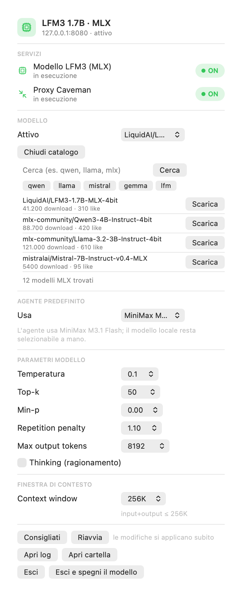

# LFM3 MLX Control

Menu bar extra per macOS che accende, spegne e configura un **server MLX locale**
(OpenAI-compatible) che può essere usato come provider custom in **MiniMax Code**
o in qualsiasi client OpenAI-compatible.

Nato per far girare **LFM3-1.7B-MLX-4bit** (Liquid AI) su Apple Silicon senza
LM Studio, che spesso dà problemi.

<p align="center">
  
  
</p>

## Funzionalità

- **Pannello personalizzato** (non un menu nativo): etichette, controlli, pulsanti
  e opzioni **tutti allineati a sinistra**
- **Accendi / spegni** il server MLX e il proxy Caveman con un click (interruttore ON/OFF)
- **Scarica modelli MLX da Hugging Face** direttamente dal pannello, con ricerca,
  filtri rapidi e barra di progresso (sezione inline: si apre e si chiude subito)
- **Modello attivo** selezionabile tra quelli installati (formato LM Studio:
  `~/.lmstudio/models/<org>/<nome>`)
- **Agente predefinito** MiniMax M3.1 Flash oppure LFM3 locale, con un click
- **Esci** / **Esci e spegni il modello** (l'app non si riavvia da sola)
- **Parametri del modello** applicati immediatamente: temperatura, top-k, min-p,
  repetition penalty, max output tokens, thinking on/off
- **Valori consigliati** con un click (temperature 0.1, top-k 50, repetition 1.1,
  thinking off)
- **Finestra di contesto** (32K → 256K) con allineamento automatico delle
  sessioni già aperte
- **Avvio automatico al login** via LaunchAgent, con riavvio se il server muore
- **Nessuna finestra**: icona nella barra dei menu, `LSUIElement`

## Requisiti

- macOS 13+ su Apple Silicon
- Xcode Command Line Tools (`xcode-select --install`)
- Python 3.12 con `mlx-lm` installato (vedi *Installazione del server*)
- Un modello MLX compatibile (es. `LiquidAI/LFM3-1.7B-MLX-4bit`)

> **Nota su LFM3**: a lungo `mlx-lm` non ha supportato l'architettura `lfm3`.
> Il server qui sotto usa la branch della PR
> [mlx-lm#2016 "Add LFM3 Support"](https://github.com/ml-explore/mlx-lm/pull/2016).

## Installazione rapida

```bash
git clone https://github.com/dex-community/lfm3-mlx-control.git
cd lfm3-mlx-control
./install.sh
```

Solo la Menu Bar Extra si può scaricare anche come asset della
[release v1.1.1](https://github.com/dex-community/lfm3-mlx-control/releases/tag/v1.1.1)
(`LFM3Control-1.1.1.zip`): estrai in `/Applications` e rinomina la cartella in
`LFM3 Control.app`.

`install.sh` copia gli script in `~/.minimax/local-models`, registra i
LaunchAgent, compila la Menu Bar Extra in `/Applications/LFM3 Control.app` e
avvia tutto.

### Installazione del server MLX

```bash
uv venv --python 3.12 ~/.minimax/local-models/mlxenv
VIRTUAL_ENV=~/.minimax/local-models/mlxenv \
  uv pip install "git+https://github.com/ml-explore/mlx-lm@refs/pull/2016/head"
VIRTUAL_ENV=~/.minimax/local-models/mlxenv uv pip install fastapi uvicorn
```

Il modello si scarica a mano in `~/.lmstudio/models/LiquidAI/LFM3-1.7B-MLX-4bit`
(oppure con `huggingface-cli download LiquidAI/LFM3-1.7B-MLX-4bit`).

## Configurazione in MiniMax Code

In `~/.minimax/config.yaml`:

```yaml
custom_provider:
  mlx:
    name: LFM3 MLX (locale)
    kind: custom
    enabled: true
    api: openai-completions
    options:
      baseURL: http://127.0.0.1:8080/v1
      authMode: api-key
      apiKey: sk-mlx-local
    models:
      lfm3-1.7b-mlx:
        name: LFM3-1.7B-MLX-4bit (locale)
        enabled: true
        tool_call: true
        modalities:
          input: [text]
          output: [text]
        limit:
          context: 262144
          output: 8192
defaultModel: custom_provider:mlx/lfm3-1.7b-mlx
```

## Note sull'implementazione del pannello

Il pannello è una `MenuBarExtra` con `.menuBarExtraStyle(.window)` (il menu nativo
imporrebbe sottomenu e righe a tutta larghezza) e **osserva direttamente** il
`ModelStore`: se il pannello osservasse solo `AppState`, le variazioni di
`showDownloader` non propagherebbero e la sezione comparirebbe solo alla riapertura.

Il catalogo è una sezione inline e non uno `sheet`: nei pannelli della barra dei menu
la presentazione modale viene rimandata e lo stato risulta "congelato" fino a
chiudere e riaprire il pannello. Anche lo `ScrollView` è stato sostituito da una
lista semplice (i pannelli MenuBar non gestiscono bene lo scroll), con i primi 6
modelli e filtri rapidi per famiglia.

## Comandi (modelli)

```bash
# modelli installati
~/.minimax/local-models/scripts/models.py list-installed
# catalogo MLX su Hugging Face
~/.minimax/local-models/scripts/models.py list-remote "qwen"
# download (stampa righe JSON di progresso)
~/.minimax/local-models/scripts/models.py download mlx-community/Qwen2.5-0.5B-Instruct-4bit
# modello servito dal server
~/.minimax/local-models/scripts/models.py set-active ~/.lmstudio/models/LiquidAI/LFM3-1.7B-MLX-4bit
```

## Hint di sistema e modelli piccoli

I modelli da 1-2B tendono a copiare nel contesto il percorso di un file allegato
(es. `~/.minimax/v2/assets/...`) e a usarlo come directory di lavoro, causando
comandi falliti a ripetizione. Il server può iniettare un hint di sistema
automatico:

```
MLX_SYSTEM_HINT="Working directory: usa SEMPRE percorsi relativi alla directory
di lavoro corrente della sessione. Non usare mai come directory di lavoro i
percorsi degli asset allegati, delle cache o di /tmp: sono file allegati, non
il progetto. Se un comando fallisce, correggi il percorso invece di ripeterlo."
```

Il valore di default è impostato da `scripts/start-mlx-server.sh` e può essere
disattivato con `MLX_SYSTEM_HINT=""`.

## Comandi

```bash
~/.minimax/local-models/lfm3-mlx.sh status          # stato del server
~/.minimax/local-models/lfm3-mlx.sh start|stop|restart
~/.minimax/local-models/lfm3-mlx.sh test            # richiesta di prova
~/.minimax/local-models/lfm3-mlx.sh set-context 131072
~/.minimax/local-models/lfm3-mlx.sh fix-sessions     # allinea le sessioni aperte
~/.minimax/local-models/lfm3-mlx.sh logs
```

## Come funziona

```
MiniMax Code ──▶ http://127.0.0.1:8080/v1 ──▶ mlx_lm.server ──▶ LFM3 MLX (Metal)
                          ▲
             start-mlx-server.sh  legge  model-settings.json
```

`start-mlx-server.sh` è un wrapper: legge i parametri da
`~/.minimax/local-models/model-settings.json` e li traduce in variabili
d'ambiente per `mlx_lm.server`. Cambiare un parametro dalla menu bar scrive il
file e riavvia il servizio.

## Note tecniche

### Contesto e compattazione

MiniMax Code calcola per ogni modello:

```
providerInputLimit = min(floor(contextWindow * 0.95),
                          contextWindow - 16384,
                          contextWindow - output - 2048)
```

e compatta automaticamente quando i token lo superano. Il prompt di base di un
agente (system prompt + tool + skills) è di ~31.500 token: con
`context: 32768` la soglia (16.384) viene superata e la richiesta viene
**rifiutata in admission** (`POST_ADMISSION_FAILED`), con la compattazione che
fallisce a cascata.

Da qui `limit.context: 262144` (input + output = 256K, il massimo dichiarato dal
modello).

**Il runtime congela `effectiveModelContextWindow` nei metadati della sessione
alla creazione.** Una chat aperta prima della modifica continua a usare il
vecchio limite: per questo `set-context` allinea anche le sessioni esistenti
(backup del DB in `runtime-state.backup.sqlite`).

### KV cache

Il contesto non è limitato dalla RAM: LFM3 usa sliding window + cache rotante,
quindi la KV cache resta piccola. Misure reali su 16 GB di RAM:

| Prompt | Tempo | RSS totale |
|---|---|---|
| 30.017 token | 37 s | ~1,0 GB |
| 120.017 token | 268 s | ~1,03 GB |

La quantizzazione della KV cache (`--kv-bits 8`) **non** è supportata per
LFM3: `mlx-lm` solleva `NotImplementedError: RotatingKVCache Quantization NYI`.

### Parametri consigliati per LFM3 1.7B

| Parametro | Valore | Motivo |
|---|---|---|
| `temperature` | 0.1 | a 0.0 il modello entra in loop di ragionamento |
| `top_k` | 50 | impostazione ufficiale di Liquid |
| `repetition_penalty` | 1.1 | indicata da Liquid per LFM3 |
| `enable_thinking` | false | con il thinking attivo il modello scrive `<think>` e spesso non produce mai `content` |

## Caveman (opzionale)

[Caveman](https://github.com/JuliusBrussee/caveman) comprime localmente ciò che
l'agente legge. Il proxy è un mount OpenAI-compatible:

```yaml
# ~/.caveman/caveman.yaml
mode: compress
compat:
  mlx:
    base_url: http://127.0.0.1:8080/v1
    api_key_env: MLX_API_KEY
```

con `CAVE_SSRF_ALLOWLIST=127.0.0.1:8080`. Il provider in MiniMax Code punta
alla porta 8787:

```
baseURL: http://127.0.0.1:8787/compat/mlx/v1
```

Attenzione: in modalità `compress` il proxy sostituisce l'output dei tool con
handle `<<ccr:...>>`, recuperabili solo via il server MCP `caveman`. Con modelli
piccoli la qualità delle risposte peggiora: per questo il default di questo
progetto è il provider diretto.

## Licenza

MIT — vedi [LICENSE](LICENSE).
